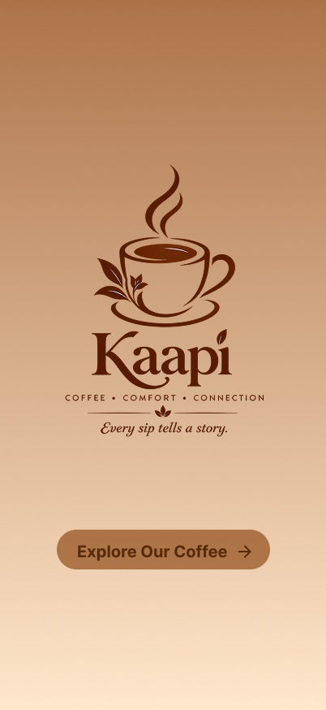
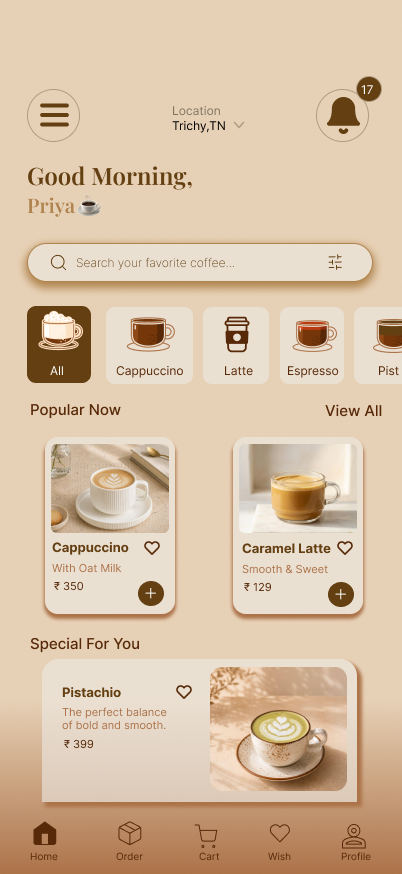
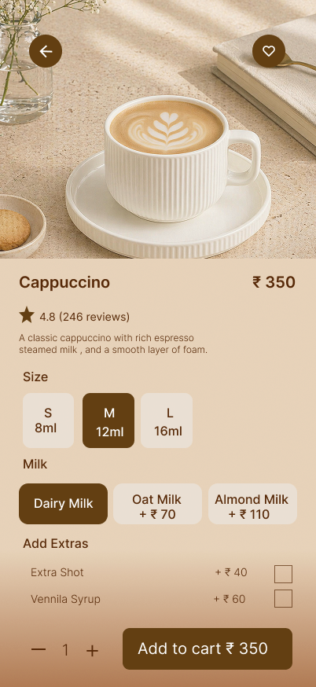
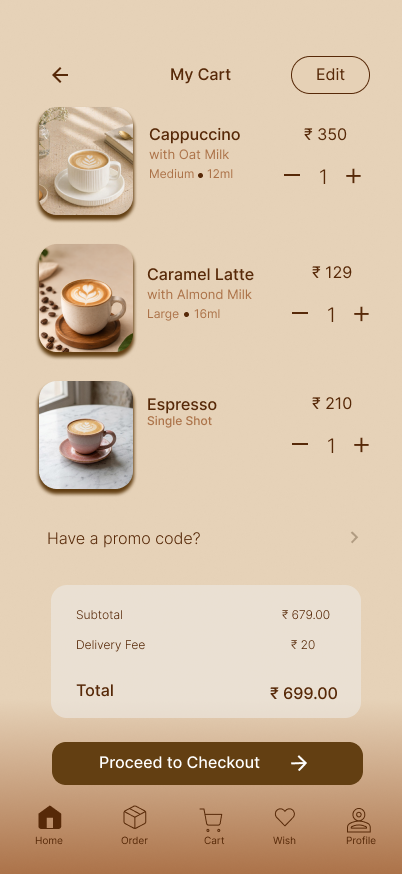
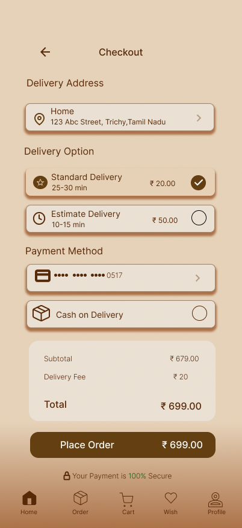
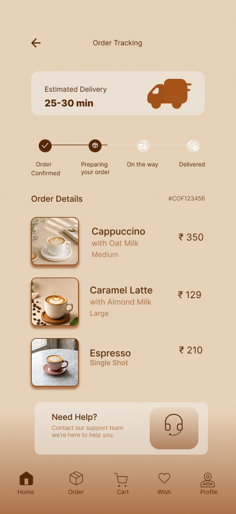

# kaapi-coffee-shop-ui
A coffee shop mobile app UI designed in Figma.

# ☕ Kaapi — Coffee Shop Mobile App UI

### Every sip tells a story.

Kaapi is a coffee shop mobile app UI concept designed in Figma. It combines a warm visual identity with a clean, user-friendly interface to create an inviting coffee-ordering experience.

## 🎨 Project Overview

- **Project Type:** UI/UX Design
- **Design Tool:** Figma
- **Platform:** Mobile App
- **Category:** Food & Beverage

## ✨ Design Goals

- Create a warm and welcoming coffee brand identity.
- Present coffee products in an appealing way.
- Keep navigation simple and intuitive.
- Design a smooth and user-friendly ordering experience.

## 📱 UI Screenshots

## 🔗 Interactive Prototype

[Explore the Kaapi Figma Prototype](https://www.figma.com/proto/7U1xLl00hbs3yy1okpcEtZ/Coffee-shop?node-id=0-1&t=9yRS3vIrdwMiOGoQ-1)

## 🛠️ Tools Used

- Figma
- UI Design
- Prototyping

## 👩‍🎨 Designer

**Priya Dharshini M**

*Designed with creativity and a love for coffee. ☕*
